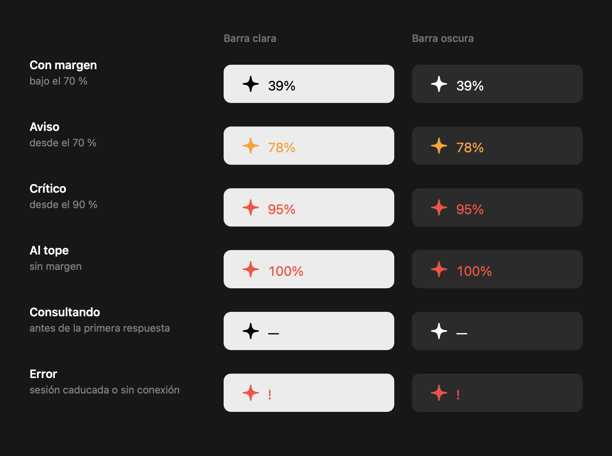
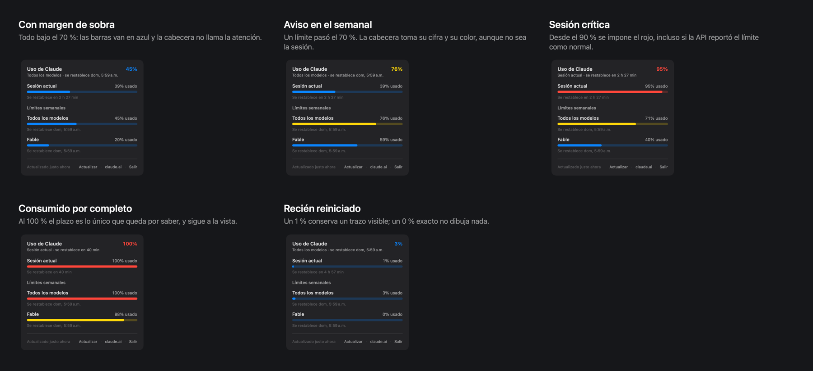
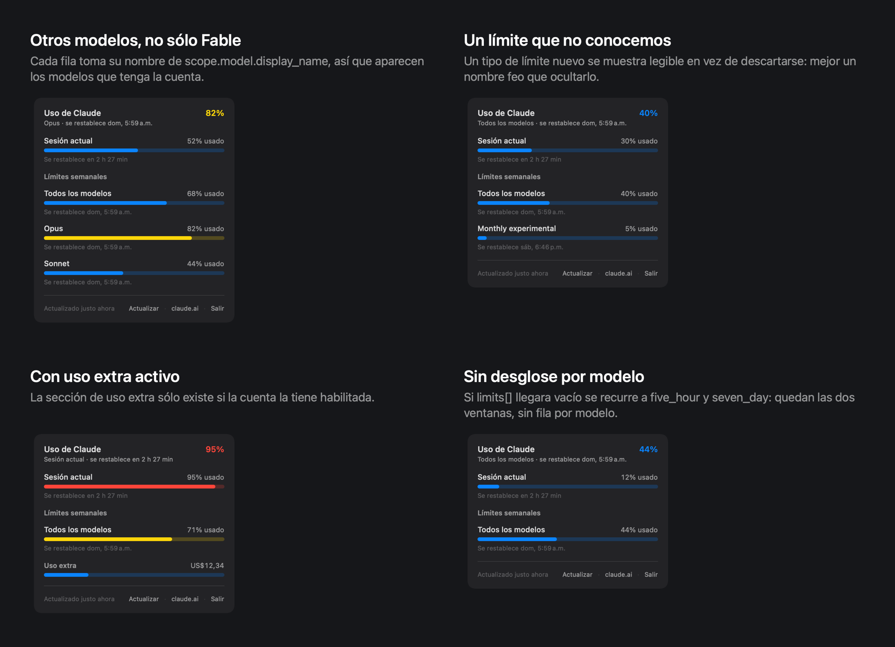
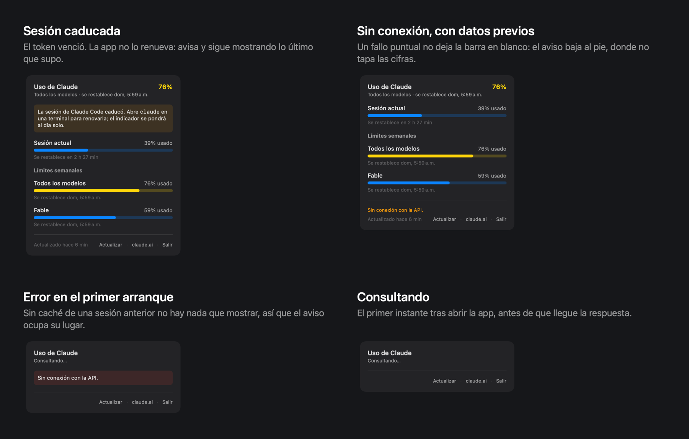
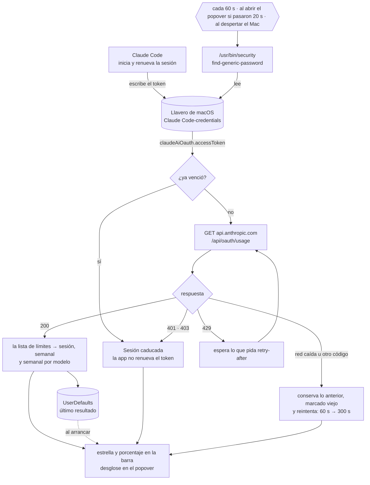

# Claude Usage Bar

Indicador de uso de Claude en la barra de menú de macOS: una estrella con el porcentaje al lado, y un
popover con el desglose completo — la sesión de 5 h, los límites semanales y cuándo se restablece cada
uno.

Son los mismos datos que muestra `/usage` en Claude Code y la pantalla **Ajustes → Uso** de claude.ai,
sin tener que abrir ninguna de las dos.



## Requisitos

- macOS 14 o posterior (probado en 15.6)
- Xcode o la toolchain de Swift 6
- Claude Code con sesión iniciada (haber ejecutado `claude` al menos una vez)

## Instalación

```bash
git clone https://github.com/alisonvivanco/claude-usage-bar.git
cd claude-usage-bar
Scripts/make-app.sh
cp -R build/ClaudeUsageBar.app /Applications/
open /Applications/ClaudeUsageBar.app
```

Clic izquierdo abre el popover; clic derecho abre el menú con *Actualizar ahora*, *Abrir en
claude.ai*, *Iniciar al abrir sesión* y *Salir*.

Para trabajar sobre el código:

```bash
swift build                # compilar
swift run ClaudeUsageBar   # ejecutar sin empaquetar
swift test                 # 30 pruebas
```

## El ítem de la barra de menú

El porcentaje corresponde al límite **más consumido** de todos, no siempre a la sesión: ese es el que
va a frenar el trabajo primero. Los dígitos son de ancho fijo para que el ítem no se ensanche al pasar
de 9 % a 78 %, empujando los íconos vecinos.

| Estado | Cuándo | Aspecto |
| --- | --- | --- |
| Con margen | bajo el 70 % | estrella monocroma; la barra de menú le aplica su propio color |
| Aviso | desde el 70 % | naranja |
| Crítico | desde el 90 % | rojo |
| Consultando | antes de la primera respuesta | `—` en lugar del número |
| Error | sesión caducada o sin conexión | `!` y estrella roja; el tooltip dice cuál de los dos |
| Datos viejos | mostrando la caché | el ítem se atenúa hasta que la API confirme |

En la barra de menú se avisa en **naranja** y no en el ámbar que usan las barras del popover: ese
amarillo casi no contrasta sobre una barra de menú clara.

## El popover

La cabecera repite el límite más consumido con su color. Las secciones aparecen sólo si hay algo que
poner en ellas: sin límites semanales no hay título de semanales, y sin uso extra habilitado esa
sección no existe.

### Cuánto queda



Los umbrales son propios y se cruzan con lo que informa la API: si el endpoint reporta un límite como
`normal` pero va al 95 %, se muestra en rojo. Al revés no — nunca se rebaja una advertencia del
servidor.

### Qué límites aparecen



Cada fila por modelo toma su nombre de `scope.model.display_name`, así que aparecen los modelos que
tenga la cuenta — Fable, Opus, Sonnet o los que vengan después. Un tipo de límite que la app no conoce
se muestra igual, con el nombre que traiga: preferimos un rótulo feo antes que ocultar un límite que
existe.

### Cuando algo falla



Un fallo puntual nunca deja el indicador en blanco: se conservan las últimas cifras y el aviso baja al
pie, donde no tapa los datos. Sólo cuando no hay nada en caché el aviso ocupa el lugar de las barras.

## Cómo obtiene la información

La app no tiene credenciales propias: reutiliza la sesión que Claude Code ya guardó en el llavero de
macOS, y la relee en cada consulta para que un token renovado se tome solo.



**El token se relee, no se guarda.** Se lee con `/usr/bin/security` en cada consulta y no se copia a
ningún archivo. La primera vez macOS puede pedir autorización, porque el ítem del llavero lo creó otra
app; con **Permitir siempre** no vuelve a preguntar.

**No renueva la sesión.** Rotar el *refresh token* desde otro proceso puede invalidar la sesión de
Claude Code. Si el token vence, la app avisa y espera: Claude Code lo renueva en el llavero y la
siguiente consulta toma el nuevo.

**Un fallo no borra lo que había.** Ante un error se conservan las últimas cifras, marcadas como
viejas, y el reintento se espacia de 60 s a 300 s. Si la API pide esperar con `retry-after`, se
respeta.

**Campos nuevos no rompen nada.** El endpoint no es una API pública documentada: es el que consume
Claude Code, y puede cambiar sin aviso. Por eso todo campo desconocido se ignora en vez de fallar, y la
interfaz se construye sobre `limits[]`, con `five_hour`/`seven_day` como respaldo si esa lista llegara
vacía.

## Desarrollo

Para comprobar sin interfaz que el llavero y el endpoint responden — y para comparar las cifras con
`/usage` en Claude Code:

```bash
CLAUDE_USAGE_BAR_PRINT=1 swift run ClaudeUsageBar
#   Sesión actual: 52% usado — se restablece en 2 h 44 min
# ! Todos los modelos: 78% usado — se restablece dom, 6:00 a.m.
#   Fable: 60% usado — se restablece dom, 6:00 a.m.
```

Otras variables evitan tocar la red y el llavero mientras se trabaja en la interfaz:

```bash
# Pintar una respuesta guardada en vez de consultar la API
CLAUDE_USAGE_BAR_FIXTURE=Tests/UsageCoreTests/Fixtures/usage-critical.json swift run ClaudeUsageBar

# Abrir el popover al arrancar, para revisarlo con una captura de pantalla
CLAUDE_USAGE_BAR_AUTO_OPEN=1 swift run ClaudeUsageBar

# Forzar un token concreto (para probar el estado de sesión caducada)
CLAUDE_USAGE_BAR_TOKEN=sk-ant-oat01-invalido swift run ClaudeUsageBar
```

### Las láminas de este README

Las imágenes de arriba no son capturas de pantalla: la barra de menú y el popover reales no se pueden
capturar sin conceder permiso de grabación de pantalla. Las dibuja la app misma, con el mismo código
que corre en producción:

```bash
swift run GenerateDocs docs/img
```

Cada caso se define como la respuesta cruda del endpoint y se decodifica con el decodificador real, así
que las láminas no pueden desviarse de lo que la app muestra. Las pruebas usan la misma técnica:
`SNAPSHOT_DIR=/ruta swift test` deja los renders donde se le indique.

### Estructura

```
Sources/UsageCore/         toda la lógica, testeable
  Model/                   respuesta de la API, normalización a LimitGauge, cliente y store
  Auth/TokenSource.swift   lectura del llavero
  UI/                      popover, filas y el ítem de la barra
  Support/Formatters.swift textos en es-CL
Sources/ClaudeUsageBar/    NSStatusItem, NSPopover y menú contextual
Sources/GenerateDocs/      las láminas de este README
```

### Preparar una versión para repartir

`Scripts/make-app.sh` firma de forma ad-hoc, que sirve para uso propio: en otro Mac, macOS avisaría que
no puede comprobar el software y habría que abrirla con clic derecho la primera vez.

Para que se abra con doble clic en cualquier Mac hay que firmarla con un certificado *Developer ID
Application* y notarizarla, lo que requiere una cuenta del Apple Developer Program:

```bash
Scripts/release.sh 1.0        # → build/ClaudeUsageBar-1.0.dmg, firmado y notarizado
```

El script compila, firma con *hardened runtime* y sello de tiempo, arma un DMG con el atajo a
Aplicaciones, lo envía a notarizar, grapa el resultado y lo comprueba con `spctl` como lo haría un Mac
que acaba de descargarlo. Si falta algo, se detiene y dice exactamente qué.

Antes de la primera vez, en la máquina que tenga la cuenta:

1. Crear el certificado en developer.apple.com → *Certificates* → **Developer ID Application** e
   instalarlo en el llavero. El de tipo *Apple Development* no sirve para distribuir, aunque aparezca
   en la lista de identidades.
2. Guardar las credenciales de notarización una sola vez:

   ```bash
   xcrun notarytool store-credentials "claude-usage-bar" \
     --apple-id <correo de la cuenta> --team-id <TEAMID> \
     --password <app-specific password de appleid.apple.com>
   ```

   La contraseña específica de app se genera en appleid.apple.com; no es la del Apple ID.

### Inicio automático

*Iniciar al abrir sesión* usa `SMAppService.mainApp`. Con firma ad-hoc macOS puede rechazarlo; en ese
caso sirve un LaunchAgent en `~/Library/LaunchAgents/cl.alisonvivanco.claude-usage-bar.plist`:

```xml
<?xml version="1.0" encoding="UTF-8"?>
<!DOCTYPE plist PUBLIC "-//Apple//DTD PLIST 1.0//EN" "http://www.apple.com/DTDs/PropertyList-1.0.dtd">
<plist version="1.0">
<dict>
	<key>Label</key>
	<string>cl.alisonvivanco.claude-usage-bar</string>
	<key>ProgramArguments</key>
	<array>
		<string>/Applications/ClaudeUsageBar.app/Contents/MacOS/ClaudeUsageBar</string>
	</array>
	<key>RunAtLoad</key>
	<true/>
</dict>
</plist>
```

```bash
launchctl load ~/Library/LaunchAgents/cl.alisonvivanco.claude-usage-bar.plist
```

## Fuera de alcance

Historial y gráficas de consumo, cálculo de tokens y costo desde los `.jsonl` de
`~/.claude/projects/`, notificaciones al cruzar umbrales, y cuentas que usan `ANTHROPIC_API_KEY` en vez
de OAuth.

## Licencia

MIT — ver [LICENSE](LICENSE).
