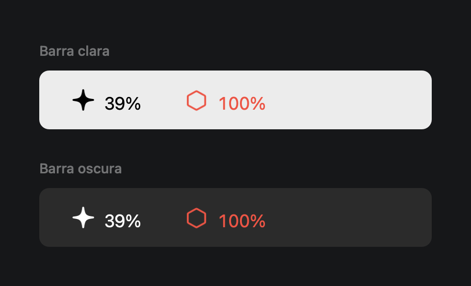
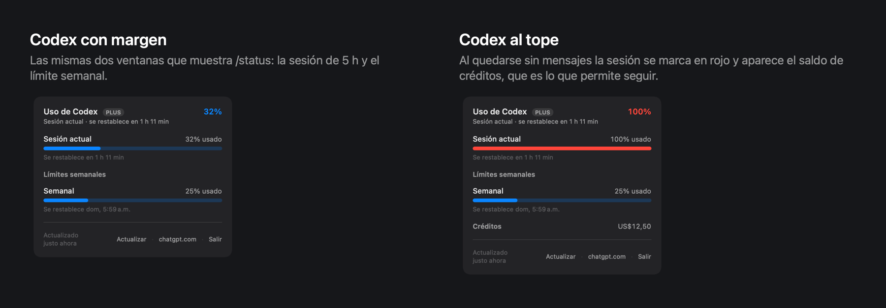
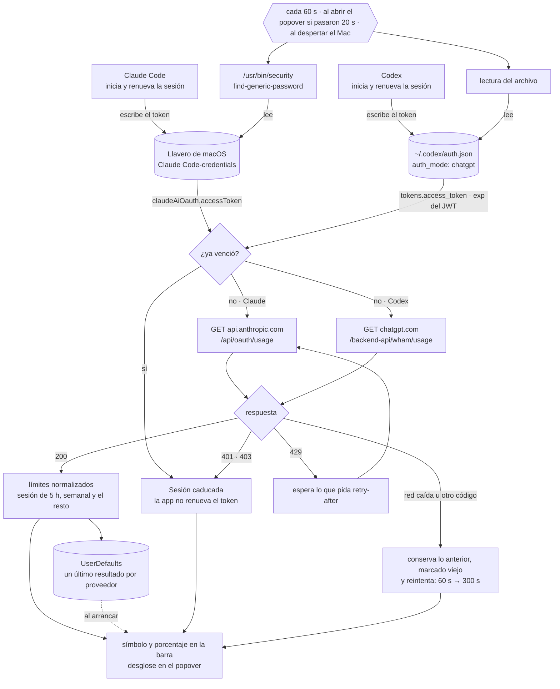

# AI Usage Bar

Indicador de uso de **Claude y Codex** en la barra de menú de macOS: un ítem por proveedor, con su
símbolo y el porcentaje al lado, y un popover con el desglose completo — la sesión de 5 h, los límites
semanales y cuándo se restablece cada uno.

Son los mismos datos que muestran `/usage` en Claude Code y `/status` en Codex, sin tener que abrir
ninguno de los dos.



Cada proveedor va en su propio ítem y no en uno solo con dos cifras: así cada uno conserva el color de
su estado, y un Codex al tope no tiñe de rojo un indicador de Claude que está holgado.

**Sólo aparece el proveedor con sesión iniciada.** Quien únicamente usa Claude Code ve un ícono, no
dos. La comprobación se rehace cuando el Mac despierta, así que instalar el otro después no obliga a
reiniciar la app.

## Requisitos

- macOS 13 o posterior (probado en 13.7 y 15.6)
- Xcode o las Command Line Tools, con Swift 5.8 o posterior
- Claude Code con sesión iniciada (haber ejecutado `claude` al menos una vez), Codex con sesión de
  ChatGPT iniciada, o ambos

## Instalación

**[Descargar AIUsageBar.dmg](https://github.com/GonzaloAfa/ai-usage-bar/releases/latest/download/AIUsageBar.dmg)**
— firmado y notarizado, para Apple Silicon e Intel. Se abre el DMG, se arrastra la app a Aplicaciones
y listo.

Para compilarla desde el código:

```bash
git clone https://github.com/GonzaloAfa/ai-usage-bar.git
cd ai-usage-bar
Scripts/make-app.sh
cp -R build/AIUsageBar.app /Applications/
open /Applications/AIUsageBar.app
```

En macOS 13 con las Command Line Tools 14.x, SwiftPM falla al arrancar con `unable to lookup item
'PlatformPath'`. Ahí se empaqueta con `Scripts/make-app-swiftc.sh`, que compila con `swiftc` sin pasar
por SwiftPM y deja la misma `build/AIUsageBar.app`. Esas herramientas no traen XCTest, así que
`swift test` tampoco corre: hace falta Xcode.

Clic izquierdo abre el popover de ese proveedor; clic derecho abre su menú con *Actualizar ahora*,
*Abrir en claude.ai* o *Abrir en chatgpt.com*, *Iniciar al abrir sesión* y *Salir*.

Si prefieres que lo haga un agente de terminal —Claude Code, Codex u otro— [AGENTS.md](AGENTS.md) es
el procedimiento completo y repetible: comprobaciones previas, instalación, inicio automático al
abrir sesión, cómo verificar el resultado sin permiso de grabación de pantalla y qué no debe tocar.

Para trabajar sobre el código:

```bash
swift build           # compilar
swift run AIUsageBar  # ejecutar sin empaquetar
swift test            # 49 pruebas
```

## El ítem de la barra de menú

El porcentaje corresponde al límite **más consumido** de ese proveedor, no siempre a la sesión: ese es
el que va a frenar el trabajo primero. Los dígitos son de ancho fijo para que el ítem no se ensanche al
pasar de 9 % a 78 %, empujando los íconos vecinos.

| Estado | Cuándo | Aspecto |
| --- | --- | --- |
| Con margen | bajo el 70 % | símbolo monocromo; la barra de menú le aplica su propio color |
| Aviso | desde el 70 % | naranja |
| Crítico | desde el 90 % | rojo |
| Consultando | antes de la primera respuesta | `—` en lugar del número |
| Error | sesión caducada o sin conexión | `!` y símbolo rojo; el tooltip dice cuál de los dos |
| Datos viejos | mostrando la caché | el ítem se atenúa hasta que la API confirme |


Claude usa la estrella de cuatro puntas que el sistema ya emplea para lo relacionado con IA; Codex, un
hexágono. En la barra de menú se avisa en **naranja** y no en el ámbar que usan las barras del popover:
ese amarillo casi no contrasta sobre una barra de menú clara.

## El popover

La cabecera repite el límite más consumido con su color, junto al plan cuando la API lo informa. Las
secciones aparecen sólo si hay algo que poner en ellas: sin límites semanales no hay título de
semanales, y sin uso extra ni créditos esa sección no existe.

### Cuánto queda


Los umbrales son propios y se cruzan con lo que informa la API: si el endpoint reporta un límite como
`normal` pero va al 95 %, se muestra en rojo. Al revés no — nunca se rebaja una advertencia del
servidor.

### Qué límites aparecen


En Claude, cada fila por modelo toma su nombre de `scope.model.display_name`, así que aparecen los
modelos que tenga la cuenta — Fable, Opus, Sonnet o los que vengan después. Un tipo de límite que la
app no conoce se muestra igual, con el nombre que traiga: preferimos un rótulo feo antes que ocultar un
límite que existe.

### Codex



Codex informa dos ventanas: la sesión de cinco horas y el límite semanal. Se clasifican por su
**duración** y no por el nombre `primary`/`secondary` que les pone la API, que describe el orden en que
las manda y no lo que miden. Al quedarse sin mensajes aparece el saldo de créditos, que es lo que
permite seguir trabajando.

### Cuando algo falla


Un fallo puntual nunca deja el indicador en blanco: se conservan las últimas cifras y el aviso baja al
pie, donde no tapa los datos. Sólo cuando no hay nada en caché el aviso ocupa el lugar de las barras.

## Cómo obtiene la información

La app no tiene credenciales propias: reutiliza las sesiones que Claude Code y Codex ya dejaron en esta
máquina, y las relee en cada consulta para que un token renovado se tome solo.



**El token se relee, no se guarda.** El de Claude se lee con `/usr/bin/security` en cada consulta; el
de Codex, desde `~/.codex/auth.json`. Ninguno se copia a otro archivo. La primera vez macOS puede pedir
autorización para el llavero, porque el ítem lo creó otra app; con **Permitir siempre** no vuelve a
preguntar. El archivo de Codex sólo se lee, nunca se escribe.

**No renueva ninguna sesión.** Rotar un *refresh token* desde otro proceso puede invalidar la sesión de
Claude Code o de Codex. Si un token vence, la app avisa y espera: el proveedor lo renovará por su
cuenta y la siguiente consulta tomará el nuevo. El de Codex es un JWT, así que su vencimiento se lee
del propio token y no se gasta una llamada que ya se sabe que va a fallar.

**Un fallo no borra lo que había.** Ante un error se conservan las últimas cifras, marcadas como
viejas, y el reintento se espacia de 60 s a 300 s. Si la API pide esperar con `retry-after`, se
respeta. Cada proveedor tiene su propia caché, así que un fallo de uno no afecta lo que muestra el
otro.

**Campos nuevos no rompen nada.** Ninguno de los dos endpoints es una API pública documentada: son los
que consumen Claude Code y Codex, y pueden cambiar sin aviso. Por eso todo campo desconocido se ignora
en vez de fallar. En Claude la interfaz se construye sobre `limits[]`, con `five_hour`/`seven_day` como
respaldo si esa lista llegara vacía; en Codex cada campo se decodifica por separado, de modo que uno
que cambie de forma se pierde solo sin llevarse el resto de la respuesta.

## Desarrollo

Para comprobar sin interfaz que las credenciales y los endpoints responden — y para comparar las cifras
con `/usage` en Claude Code y `/status` en Codex:

```bash
AI_USAGE_BAR_PRINT=1 swift run AIUsageBar
# — Claude —
#   Sesión actual: 52% usado — se restablece en 2 h 44 min
# ! Todos los modelos: 78% usado — se restablece dom, 6:00 a.m.
#   Fable: 60% usado — se restablece dom, 6:00 a.m.
#
# — Codex —
# Plan: plus
# !! Sesión actual: 100% usado — se restablece en 16 min
#   Semanal: 25% usado — se restablece mié, 1:34 p.m.
```

Otras variables evitan tocar la red y las credenciales mientras se trabaja en la interfaz. Todas van
por proveedor, porque cada uno tiene su propia forma de respuesta:

```bash
# Pintar respuestas guardadas en vez de consultar las APIs
AI_USAGE_BAR_FIXTURE_CLAUDE=Tests/UsageCoreTests/Fixtures/usage-critical.json \
AI_USAGE_BAR_FIXTURE_CODEX=Tests/UsageCoreTests/Fixtures/codex-limit-reached.json \
  swift run AIUsageBar

# Abrir los popovers al arrancar, para revisarlos con una captura de pantalla
AI_USAGE_BAR_AUTO_OPEN=1 swift run AIUsageBar

# Forzar un token concreto (para probar el estado de sesión caducada)
AI_USAGE_BAR_TOKEN_CLAUDE=sk-ant-oat01-invalido swift run AIUsageBar
AI_USAGE_BAR_TOKEN_CODEX=invalido swift run AIUsageBar
```

Declarar una variable de fixture también hace aparecer a ese proveedor en la barra aunque no haya
sesión iniciada en la máquina.

### Las láminas de este README

Las imágenes de arriba no son capturas de pantalla: la barra de menú y el popover reales no se pueden
capturar sin conceder permiso de grabación de pantalla. Las dibuja la app misma, con el mismo código
que corre en producción:

```bash
swift run GenerateDocs docs/img
```

Cada caso se define como la respuesta cruda del endpoint y se decodifica con el decodificador real, así
que las láminas no pueden desviarse de lo que la app muestra. Las pruebas usan la misma técnica:
`SNAPSHOT_DIR=/ruta swift test` deja los renders donde se le indique.

### Estructura

```
Sources/UsageCore/              toda la lógica, testeable
  Provider/                     qué es un proveedor y qué cliente le corresponde
  Model/                        LimitGauge, protocolo de cliente y store
  Auth/TokenSource.swift        lectura del llavero
  Providers/Anthropic/          respuesta de api.anthropic.com y su normalización
  Providers/Codex/              respuesta de chatgpt.com, su normalización y ~/.codex/auth.json
  UI/                           popover, filas y el ítem de la barra
  Support/Formatters.swift      textos en es-CL
Sources/AIUsageBar/             un NSStatusItem por proveedor, popovers y menús
Sources/GenerateDocs/           las láminas de este README
```

Añadir un tercer proveedor es escribir su cliente en `Providers/`, que devuelva un `ProviderSnapshot`,
y agregar un caso en `Provider/ProviderClients.swift`. La interfaz no conoce ningún proveedor en
particular: lee `LimitGauge`, que es neutro.

### Preparar una versión para repartir

`Scripts/make-app.sh` firma de forma ad-hoc, que sirve para uso propio: en otro Mac, macOS avisaría que
no puede comprobar el software y habría que abrirla con clic derecho la primera vez.

Para que se abra con doble clic en cualquier Mac hay que firmarla con un certificado *Developer ID
Application* y notarizarla, lo que requiere una cuenta del Apple Developer Program:

```bash
Scripts/release.sh 1.0        # → build/AIUsageBar-1.0.dmg, firmado y notarizado
```

El script compila, firma con *hardened runtime* y sello de tiempo, arma un DMG con el atajo a
Aplicaciones, lo envía a notarizar, grapa el resultado y lo comprueba con `spctl` como lo haría un Mac
que acaba de descargarlo. Si falta algo, se detiene y dice exactamente qué.

Antes de la primera vez, en la máquina que tenga la cuenta:

1. Crear el certificado en developer.apple.com → *Certificates* → **Developer ID Application** e
   instalarlo en el llavero. El de tipo *Apple Development* no sirve para distribuir, aunque aparezca
   en la lista de identidades.
2. Guardar las credenciales de notarización una sola vez:

   ```bash
   xcrun notarytool store-credentials "ai-usage-bar" \
     --apple-id <correo de la cuenta> --team-id <TEAMID> \
     --password <app-specific password de appleid.apple.com>
   ```

   La contraseña específica de app se genera en appleid.apple.com; no es la del Apple ID.

### Publicar una versión desde GitHub

`.github/workflows/release.yml` hace lo mismo que `Scripts/release.sh` en un Mac de GitHub Actions y
sube el DMG a *Releases*. Basta con empujar una etiqueta:

```bash
git tag v1.1 && git push origin v1.1
```

Corre las pruebas, compila universal, firma, notariza, grapa y publica `AIUsageBar.dmg`, que es el
archivo al que apunta el enlace de descarga de arriba. Antes de la primera vez hay que cargar cinco
secretos en *Settings → Secrets and variables → Actions*:

| Secreto | Qué es | De dónde sale |
| --- | --- | --- |
| `DEVELOPER_ID_P12` | el certificado *Developer ID Application* con su clave privada, en base64 | Acceso a Llaveros → clic derecho en el certificado → *Exportar* como .p12; luego `base64 -i cert.p12 \| pbcopy` |
| `DEVELOPER_ID_P12_PASSWORD` | la contraseña elegida al exportar | — |
| `NOTARY_KEY_P8` | clave de API de App Store Connect, en base64 | appstoreconnect.apple.com → *Users and Access* → *Integrations* → *App Store Connect API* → nueva clave con rol *Developer*; `base64 -i AuthKey_XXXX.p8 \| pbcopy` |
| `NOTARY_KEY_ID` | el *Key ID* de esa clave | la misma página |
| `NOTARY_ISSUER_ID` | el *Issuer ID* de la cuenta | la misma página, arriba de la lista |

La clave .p8 se descarga una sola vez; si se pierde, se revoca y se crea otra.

### Inicio automático

*Iniciar al abrir sesión* usa `SMAppService.mainApp`. Con firma ad-hoc macOS puede rechazarlo; en ese
caso sirve un LaunchAgent en `~/Library/LaunchAgents/cl.alisonvivanco.ai-usage-bar.plist`:

```xml
<?xml version="1.0" encoding="UTF-8"?>
<!DOCTYPE plist PUBLIC "-//Apple//DTD PLIST 1.0//EN" "http://www.apple.com/DTDs/PropertyList-1.0.dtd">
<plist version="1.0">
<dict>
	<key>Label</key>
	<string>cl.alisonvivanco.ai-usage-bar</string>
	<key>ProgramArguments</key>
	<array>
		<string>/Applications/AIUsageBar.app/Contents/MacOS/AIUsageBar</string>
	</array>
	<key>RunAtLoad</key>
	<true/>
</dict>
</plist>
```

```bash
launchctl load ~/Library/LaunchAgents/cl.alisonvivanco.ai-usage-bar.plist
```

## Fuera de alcance

Historial y gráficas de consumo, cálculo de tokens y costo en dólares desde los `.jsonl` de
`~/.claude/projects/` o `~/.codex/sessions/`, notificaciones al cruzar umbrales, y cuentas que usan
`ANTHROPIC_API_KEY` u `OPENAI_API_KEY` en vez de una sesión: esas se facturan por consumo y no tienen
límites de plan que mostrar.

## Licencia

MIT — ver [LICENSE](LICENSE). Escrito originalmente por Alison Vivanco como *Claude Usage Bar*.
